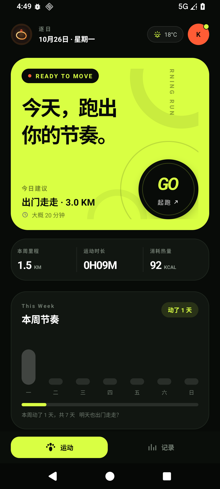
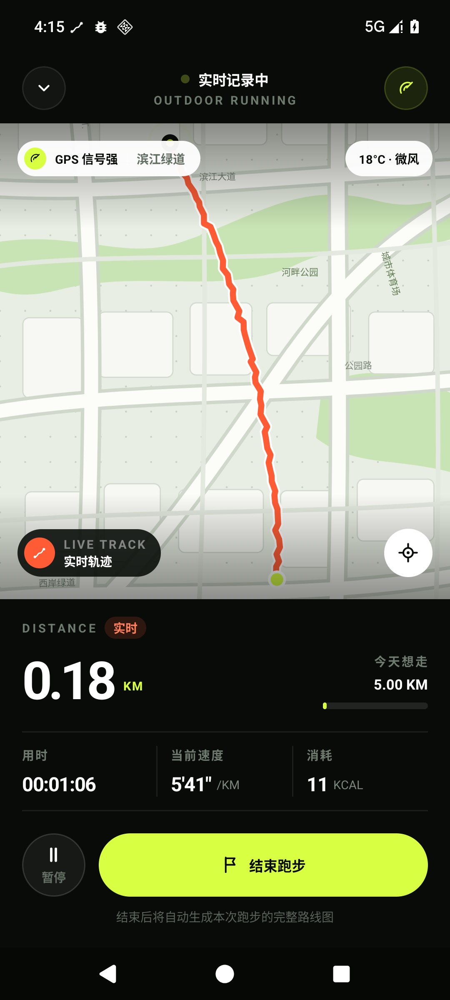
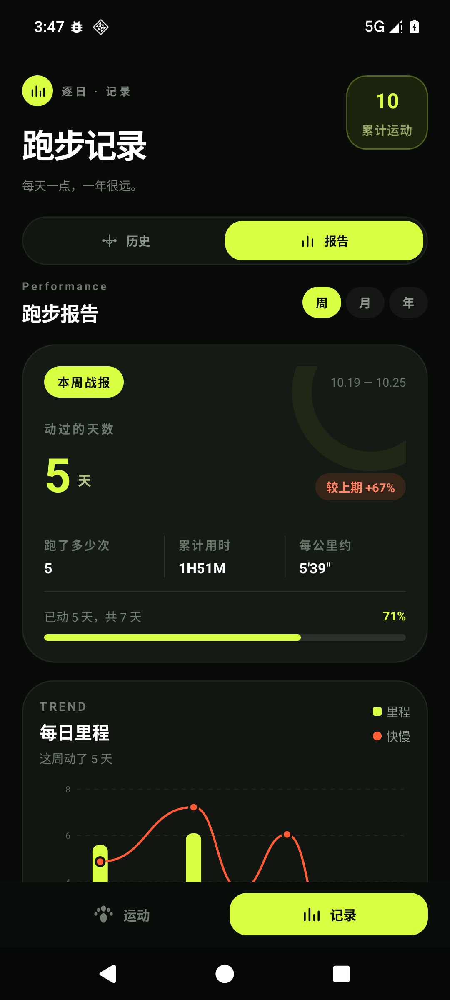
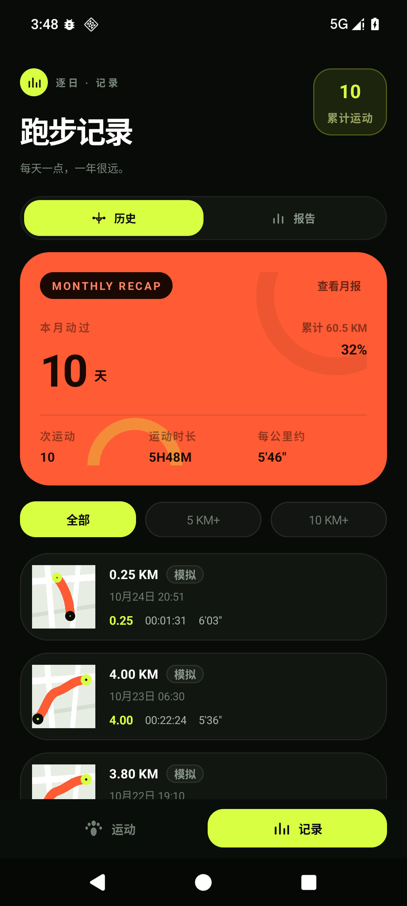
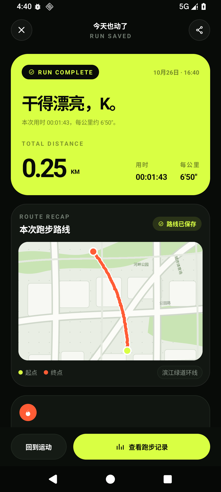
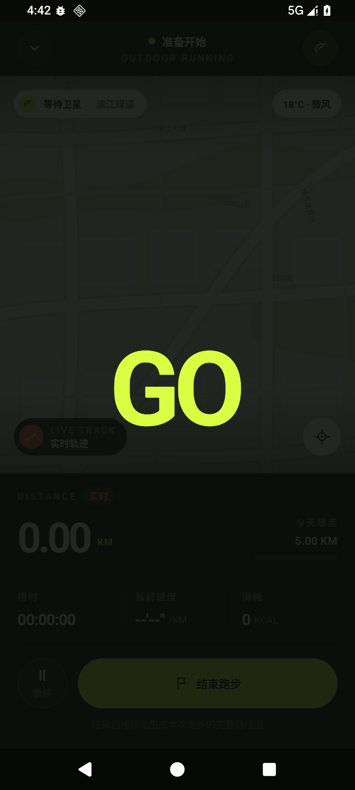
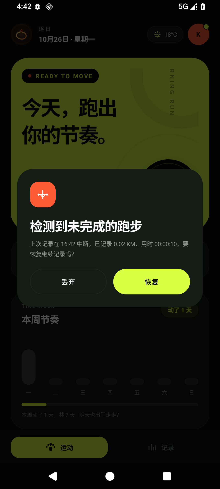
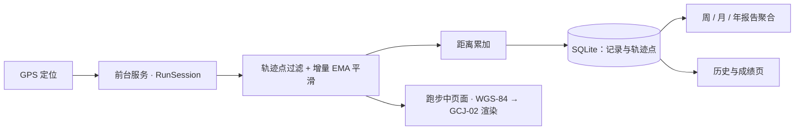

<div align="center">


### 逐日 · SUNWARD：不比快慢，只问今天动了没

面向家里人日常使用的 **无账号、无云同步** 原生 Android / Kotlin 跑步记录 App，跑步记录只存在本机。

[](android/app/build.gradle.kts)
[](android/app/build.gradle.kts)
[](android/build.gradle.kts)
[](android/gradle/wrapper/gradle-wrapper.properties)
[](LICENSE)

**[先看效果](#先看效果) · [核心能力](#核心能力) · [快速开始](#快速开始) · [技术选型](#技术选型) · [文档](#文档)**

</div>

---

**公里数是结果，不是成绩单。** 主指标是「本周动了几天」，不是「离 30 km 还差多少」。一天动了就是完成，漏掉的日子只是不增加。

- **无账号、无云同步**：跑步记录、轨迹点、报告全部存本机 SQLite，不上传。
- **频率比强度重要**：没有里程目标、没有配速目标、没有断签提醒，也没有任何红色警示。
- **锁屏继续记录**：前台服务保活，过程被强杀后进入 App 可恢复未完成的跑步。
- **原生轻量**：Kotlin + XML View，图表自绘 `Canvas`，不引图表库。

## 先看效果

装上 APK 就能跑，不需要注册或登录。想先看效果而不真去跑步，可以用内置的[模拟轨迹](#3-模拟轨迹先看效果)走一条 2.4 km 环线。

<p align="center">
  
</p>
<p align="center"><em>首页的主数字是「本周动了几天」，不是还差多少公里。</em></p>

## 想法

频率比强度重要。公里数是结果，不是成绩单。

「还差 29.9 km 达标」是欠账，跑两天看到自己欠一堆账，最可能的选择是干脆不跑了。
所以这个 App 里没有里程目标、没有配速目标、没有断签提醒，也没有任何红色警示。
一天动了就是完成，漏掉的日子只是不增加。

完整的判断依据见 [产品理念](docs/产品理念.md)。

## 核心能力

| 能力 | 你可以做什么 |
|---|---|
| **轨迹采集** | GPS 轨迹采集，前台服务保活，锁屏继续记录，中途可暂停。点起跑后先走 3-2-1 倒计时，`GO` 出现一秒后才开始计时。 |
| **距离计算** | 距离用增量 EMA 平滑后累加，过滤瞬移与漂移点。 |
| **地图渲染** | 轨迹存 WGS-84，渲染时转 GCJ-02 再交给高德；跑步中镜头跟到街道级并随跑者移动，定位标按 GPS 方位角转向（没有方位角时用罗盘兜底）；成绩页的路线图叠在真实底图上。`local` 变体用手绘底图。 |
| **本地存储** | SQLite 存记录与轨迹点，删除记录后汇总同步减少。 |
| **周 / 月 / 年报告** | 里程柱 + 快慢折线双轴图、运动构成、观察文案，主数字是动过的天数。 |
| **历史与成绩** | 记录按天归档，可筛选、可展开；成绩页看路线图、每公里用时、消耗。首页与记录页之间滑动切页，记录页支持左边缘右滑返回。 |
| **中断恢复** | 过程被强杀后进入 App 可恢复未完成的跑步。 |
| **提示卡片** | 隐私说明、中断恢复、删除确认都是自绘卡片（`SunwardDialog`），和实时页的结束确认同一套视觉，不用系统弹窗。 |

不做：排行榜、社交动态、配速目标、断签提醒。

> 网络权限只用于高德底图的瓦片下载。跑步记录、轨迹点、报告全部存本地 SQLite，不上传。

## 界面

| | |
|---|---|
|  |  |
| 跑步中：轨迹、距离、时长、当前位置 | 报告：周 / 月 / 年，主数字是动过的天数 |
|  |  |
| 历史：按天归档，可筛选、可展开 | 成绩：路线图、每公里用时、消耗 |
|  |  |
| 起跑前 3-2-1 倒计时，`GO` 满一秒才开始计时 | 自绘提示卡片：中断恢复 / 隐私说明 / 删除确认 |

## 工作原理



采集与统计分开：轨迹点落库后，报告只做聚合，删除记录后汇总同步减少。模块划分见 [目录结构](#目录结构)。

## 快速开始

以下命令在 Windows / PowerShell 下执行，需要 JDK 21 与 Android SDK。

### 1. 配置环境变量

```powershell
$env:JAVA_HOME         = 'C:\path\to\jdk-21'
$env:ANDROID_HOME      = 'D:\Sunward\tools\android-sdk'
$env:ANDROID_SDK_ROOT  = 'D:\Sunward\tools\android-sdk'
$env:ANDROID_USER_HOME = 'D:\Sunward\tools\android-user'
$env:GRADLE_USER_HOME  = 'D:\Sunward\tools\gradle-home'
```

`local.properties` 不存在时创建并写入 `sdk.dir=D:/Sunward/tools/android-sdk`。

### 2. 构建与测试

```powershell
cd android
.\gradlew.bat assembleLocalDebug     # 不含高德 SDK，可在 x86_64 模拟器安装
.\gradlew.bat assembleAmapDebug      # 含高德底图，装真机
.\gradlew.bat testLocalDebugUnitTest # 65 个单元测试
```

### 3. 模拟轨迹先看效果

```powershell
adb shell am start -n com.runclub.android/.ui.HomeActivity --ez sim true
```

模拟轨迹会走一条 2.4 km 的环线，产生一条带「模拟」标记的记录。

> 点 GO 后先走 3-2-1 倒计时，`GO` 出现满一秒才开始计时，自动化脚本要多等约 4 秒。
>
> 全新安装或 `adb shell pm clear` 之后，先执行一次
> `adb shell pm grant com.runclub.android android.permission.ACCESS_FINE_LOCATION`：
> 模拟轨迹同样跑在 `location` 类型的前台服务里，系统要求启动该服务时已持有定位权限，
> 否则服务起不来（界面上点 GO 走的是权限申请流程，不受影响）。

### 两个变体

| 变体 | 产物 | 用途 |
|---|---|---|
| `local` | `app/build/outputs/apk/local/debug/app-local-debug.apk`（7.3 MB） | 模拟器 / 无 ARM 环境，用手绘底图 |
| `amap` | `app/build/outputs/apk/amap/debug/app-amap-debug.apk`（42.7 MB） | 真机，高德底图 |

高德 3D SDK 只带 `arm64-v8a` / `armeabi-v7a` 的 native 库。把它打进主变体后，
x86_64 模拟器连安装都会报 `INSTALL_FAILED_NO_MATCHING_ABIS`，开发期没法自测。
两个变体共用同一个 `applicationId`，高德 Key 对两者都有效。

## 技术选型

| | |
|---|---|
| 语言 | Kotlin 2.2 |
| 界面 | XML View + Material 3，无 Compose |
| 架构 | Activity 观察 `StateFlow<RunUiState>`，状态在进程级单例 `RunSession` + 前台服务里 |
| 存储 | 手写 `SQLiteOpenHelper`，两张表，插入走单事务 |
| 图表 | 自绘 `Canvas`，无图表库 |
| 地图 | 高德 3D SDK（`amap` 变体）/ 手绘底图（`local` 变体） |
| minSdk / targetSdk | 26 / 36 |
| compileSdk | 37（`androidx.core:core:1.19.1` 要求 ≥ 37） |
| AGP / Gradle | 9.4.1 / 9.8.2 |

AGP 9 起 Kotlin 支持已内置，`build.gradle.kts` 里**不能**再声明 `org.jetbrains.kotlin.android` 插件。

## 名称与图标

### 名称

中文名 **逐日**，英文名 **SUNWARD**。

「逐日」一天一天地读，也是追逐每一个日头。SUNWARD 意为「向着太阳」——
`sun` 对应日，`ward` 对应趋向，与中文的逐日近乎逐字对译。

App 启动器上显示「逐日」，面向家里人的日常使用；SUNWARD 用在代码仓库、文档和对外场合。
品牌色 `#D9FF43` 就是太阳的颜色，和这个名字是一套的。

包名 `com.runclub.android` 是早期名。改动会让已申请的高德地图 Key 失效
（Key 绑定包名 + 签名 SHA-1），因此保持原样。

### 图标

启动图标 **sunward · 朝阳金**：一条跑出来的闭环轨迹 + 起点定位针。
暖棕黑底 `#1C1310`，晨光金渐变轨迹 `#FFE49A → #F0802C`，落日红定位针 `#E8502F`。

- 源文件 [design/icon/sunward-icon.svg](design/icon/sunward-icon.svg)（1024 viewBox），位图 [design/icon/sunward-icon.png](design/icon/sunward-icon.png)（1024px，商店大图可直接用）
- 自适应图标前景用**位图**：`drawable-nodpi/ic_launcher_foreground.png`，由 1024 设计稿按 0.86 缩放栅格化，内容落在 66dp 安全区内；另带矢量 `monochrome` 主题图标层（纯色描边，不受下述问题影响）
- ⚠️ **前景不要用矢量渐变描边**：实测 Android 16（API 36）上 `VectorDrawable` 的渐变 `strokeColor` 不渲染——轨迹圆环整个消失，只剩纯色填充的定位针。改用位图后正常
- 图标用的暖金色是品牌色的演进方向：首页品牌 logo 已换成同一套朝阳金标记（位图 `ic_logo_sunward.png` + 底板 `bg_logo_sunward`），App 其余界面仍是荧光绿 `#D9FF43`，后续替换

## 目录结构

```
android/app/src/
├── main/          主源码与资源
│   ├── java/com/runclub/android/
│   │   ├── tracking/     轨迹采集、过滤、距离累加、状态机
│   │   ├── session/      RunSession：跨 Activity 的状态持有者
│   │   ├── service/      前台服务（location 类型）
│   │   ├── data/         SQLite、仓库、报告聚合
│   │   ├── ui/           四个页面 + 自绘控件
│   │   ├── map/          地图抽象，坐标转换
│   │   └── util/         格式化
│   └── res/       布局、图形、颜色、文案
├── amap/          高德实现（变体）
├── local/         手绘地图实现（变体）
└── test/          59 个单元测试

design/prototype/  HTML 原型，视觉基线，不参与构建
design/icon/       启动图标 sunward（SVG 源 + 1024 PNG）
docs/              计划、验收报告、调研、产品理念
tools/             本机工具链（SDK、Gradle、模拟器脚本），不入库
```

## 文档

| 我想…… | 从这里开始 |
|---|---|
| 了解设计取舍与判断依据 | [产品理念](docs/产品理念.md) |
| 看 M0–M7 的任务拆分与验收标准 | [开发计划](docs/开发计划.md) |
| 查逐里程碑的实测记录与修过的问题 | [验收报告](docs/验收报告.md) |
| 查竞品与技术调研 | [调研报告](docs/调研报告.md) |
| 对视觉基线 | [原型](design/prototype/)：四个 HTML 页面 |
| 取图标源文件 | [图标](design/icon/)：SVG 源 + 1024 位图 |

## License

[MIT](LICENSE)。
